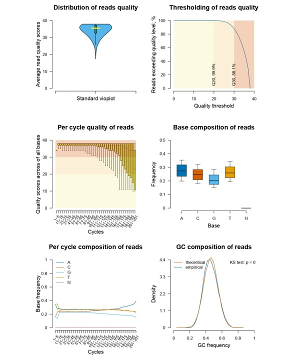
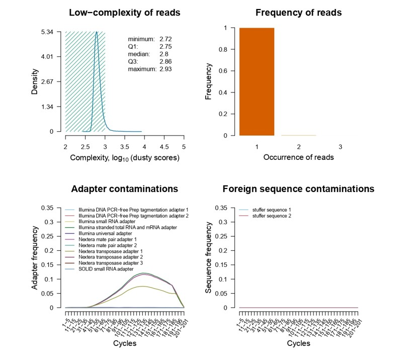
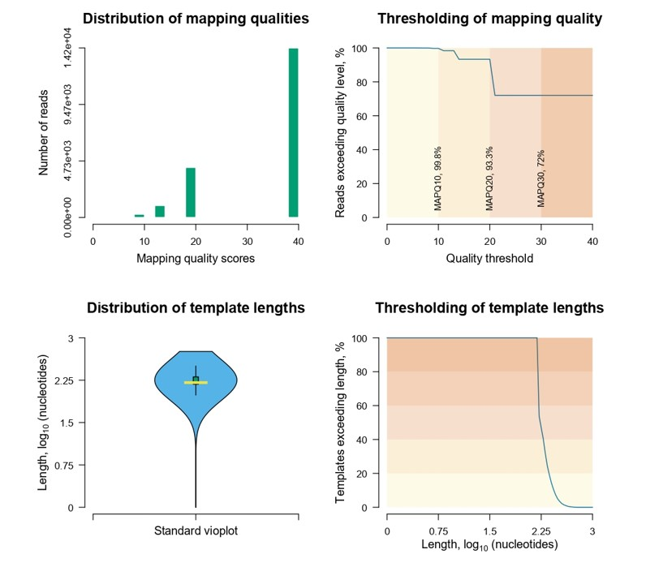

```{r setup, include=FALSE}
knitr::opts_chunk$set(
  collapse = TRUE,
  comment  = "#>"
)
```

<font size="2">This document describes the usage of the functions integrated in the package and is meant to be a reference document for the end user. </font>

<font size="2">The huGSVcalleR package is considered stable and will undergo few changes from now on. Please, report potential bugs and incompatibilities to [bioinformatics.rfct.bio.bsu\@gmail.com](mailto:bioinformatics.rfct.bio.bsu@gmail.com){.email}. </font>

The usage of the package functions for identification and annotation of single nucleotide variation sites is shown for a small test dataset. The test FASTQ, BAM and CSV files are available in the working directory and can be reproduced by following the pipeline below. All calls assume a `workDir` that contains the input files (FASTQ, BAM, reference genome, adapter and contaminant tables).

<!-- TODO: указать источник тестовых данных. Заполнитель для будущего текста:
     "The test files were generated by <TOOL/METHOD> and are available
     at <URL/DOI>. They are not shipped with the package to keep the
     tarball within Bioconductor size limits."
-->

# Installing and loading the package

Load the package with the following command:

```{r, eval = FALSE}
if (!requireNamespace("BiocManager", quietly = TRUE)) {
    install.packages("BiocManager")
}
BiocManager::install("huGSVcalleR")
```

```{r, echo=TRUE, results='hide'}
library("huGSVcalleR")
```

# External requirements

Some functionality of the package requires external software:

-   **Perl** (≥ 5.0) for `scoreSSs()` (MaxEntScan). On Windows, we recommend [Strawberry Perl](https://strawberryperl.com/). After installation, verify that Perl is visible with `Sys.which("perl")`.
-   **GATK** (≥ 4.0) for `callSNVs(criteria = "gatk")` and for the GATK pre-processing wrappers (`groupReadsGATK()`, `markDuplicatesGATK()`, `recalibrateBamGATK()`, `indexGenomeGATK()`, `indexVcfGATK()`). GATK is not natively available on Windows; use WSL2 or Docker and run GATK manually, then continue with `callSNVs(criteria = "fisher")` or another method.

# Data availability

The most important data sets (adapters, contaminants, phred scores, reference gene annotations, reference genome indices) are available ##################################################. The test files used in this vignette (`test_seq.R1.fastq.gz`, `test_seq.R2.fastq.gz`, `test_seq3.bam`, `test_seq3.PileupResults.csv`) are **not** shipped with the package to keep the tarball within Bioconductor size limits. See the Appendix for the exact source and version of the test data.

# Data loading

The first step of any analysis is to load the raw FASTQ files and to assess their quality. The function `readFASTQ()` provides low-level access to the sequences and quality scores, while `assessQRawReads()` computes the full set of quality metrics:

```{r module1-read, eval = FALSE}
fq <- readFASTQ(fastqDir = "Files_FASTQ",
                fastq    = "test_seq.R1.fastq.gz",
                n        = NULL,
                workDir  = "D:/Vasily Grinev")
str(fq, max.level = 1)
#> List of 2
#>  $ reads  : Formal class 'DNAStringSet' ...
#>  $ QScores: Formal class 'PhredQuality' ...
```

where the function argument `fastqDir` is the name of the directory containing the FASTQ file, `fastq` is the name of the FASTQ file (allowed formats are `fastq` or `fastq.gz`), `n` is the number of reads loaded into RAM (NULL means all reads), and `workDir` is the working directory. The function returns a list with two elements: a `DNAStringSet` object of read sequences and a `PhredQuality` object of read quality scores.

# Quality control of raw reads

The function `assessQRawReads()` calculates the full set of quality metrics for a FASTQ file:

```{r module1-assess, eval = FALSE}
qa_r1 <- assessQRawReads(fastqDir     = "Files_FASTQ",
                         fastq        = "test_seq.R1.fastq.gz",
                         n            = NULL,
                         adapters     = "adapters.txt",
                         contaminants = "contaminants.txt",
                         workDir      = "D:/Vasily Grinev")
str(qa_r1, max.level = 1)
#> List of 15
#>  $ SN   : chr "test_seq.R1"
#>  $ FN   : chr "test_seq.R1.fastq.gz"
#>  $ TNRs : num 50000
#>  $ TNBs : num 1e+07
#>  $ RLs  : num [1:6] 201 201 201 201 201 201
#>  $ PERQs:List of 3
#>  $ PCQRs:'data.frame':    41 obs. of  6 variables
#>  $ BCs  :List of 2
#>  $ PCCBs:'data.frame':    41 obs. of  6 variables
#>  $ GCs  :List of 3
#>  $ DSs  :List of 3
#>  $ FRs  :'data.frame':    3 obs. of  3 variables
#>  $ ORs  :'data.frame':    20 obs. of  2 variables
#>  $ ASs  :'data.frame':    41 obs. of  12 variables
#>  $ FSs  :'data.frame':    41 obs. of  3 variables
```

where the argument `adapters` is the name of a tab-delimited TXT file with adapter sequences (three fields: `adapter_id`, `adapter_name`, `adapter_sequence`), and `contaminants` is the name of a tab-delimited TXT file with foreign sequences (`foreign_id`, `foreign_name`, `foreign_sequence`). If `adapters` or `contaminants` is NULL, the corresponding search is not performed.

The function returns a list with 15 slots: sample name, file name, total numbers of reads and bases, read length distribution, per-read and per-cycle quality, base composition, GC content, low-complexity (dusty) scores, read frequency, overrepresented reads, and (optionally) adapter and foreign-sequence hits. As demonstrated in Figure 1, the distribution of reads by quality is replaced by the distribution of the fraction of reads exceeding a quality threshold, and the Q-Q plot of GC content is replaced by the density plot of empirical and theoretical (normal) distributions with the Kolmogorov–Smirnov test.

```{r figure1, echo=FALSE, fig.wide=TRUE, out.width='100%'}

```
Figure 1. Summary plots of raw read quality: distribution of reads quality, thresholding of reads quality, per cycle quality of reads, base composition of reads, per cycle composition of reads, and GC composition of reads.

The function `reportQAResults()` consolidates the results into three files:

```{r module1-report, eval = FALSE}
report <- reportQAResults(x       = qa_r1,
                          output  = NULL,
                          workDir = "D:/Vasily Grinev")
list.files("D:/Vasily Grinev", pattern = "^QA|^Overrepresented")
#> [1] "QA metrics of test_seq.R1.pdf"
#> [2] "QA plots of test_seq.R1.pdf"
#> [3] "Overrepresented reads of test_seq.R1.fasta"
```

-   `QA metrics of <sample>.pdf` — 49 summary statistics in a table;
-   `QA plots of <sample>.pdf` — a multi-page graphical report (Figure 2);
-   `Overrepresented reads of <sample>.fasta` — most frequent reads.

```{r figure2, echo=FALSE, fig.wide=TRUE, out.width='100%'}

```
Figure 2. Summary plots of raw read quality (continuation): low-complexity of reads (log10 of dusty scores), frequency of reads, adapter contaminations, and foreign sequence contaminations.

The function `cleanRawReads()` performs up to seven filtering steps: adapter trimming (left and right), fixed or dynamic quality trimming (`trimEnds`, `trimTails`, `trimTailw`), length filter, quality filter, ambiguous nucleotide filter, duplicate filter, and low-complexity filter:

```{r module1-clean, eval = FALSE}
cleanRawReads(fastqDir  = "Files_FASTQ",
              fastq1    = "test_seq.R1.fastq.gz",
              fastq2    = "test_seq.R2.fastq.gz",
              adapters  = "adapters.txt",
              error     = 0.2,
              tr_score  = 20,
              phred     = "phred_scores.txt",
              readl     = 100,
              readq     = 20,
              readn     = 3,
              dustScore = 875,
              postfix   = "filtered",
              overwrite = TRUE,
              workDir   = "D:/Vasily Grinev")
```

where `error` is the error rate for adapter matching, `tr_score` is the quality score at or below which a nucleotide is marked as removable, `phred` is the name of a tab-delimited TXT file with ASCII scores (`phred_scores.txt`), `readl`/`readq`/`readn` are the minimum length, minimum quality, and maximum number of ambiguous nucleotides of reads to be saved, `dustScore` is the maximum dust score, `postfix` is the postfix added to the output file names, and `overwrite` controls whether existing output files are replaced.

# Reads alignment

The first step of the alignment module is to build a hash table for the reference genome:

```{r module2-index, eval = FALSE}
buildIndexSubread(ref_genome = "Reference_Genomes/GRCh38",
                  ref_fasta  = "Files_FASTA",
                  index      = "GRCh38",
                  fa         = "hg38.fa.gz",
                  memory     = 8000,
                  workDir    = "D:/Vasily Grinev")
```

where `ref_genome` is the folder for storing the index, `ref_fasta` is the folder for storing the reference sequences, `index` is the basename of the created index files, `fa` is the name of the FASTA file, and `memory` is the amount of memory (MB) used for storing the index during read mapping.

The function `alignDNASubread()` aligns short DNA-Seq reads by the seed-and-vote algorithm (via `Rsubread::align()`):

```{r module2-align, eval = FALSE}
alignDNASubread(genome      = "Reference_Genomes/GRCh38/GRCh38",
                fastqDir    = "Files_FASTQ",
                fastq1      = "test_seq.filtered.R1.fastq.gz",
                fastq2      = "test_seq.filtered.R2.fastq.gz",
                bamDir      = "Files_BAM",
                bamFile     = "test_seq.filtered.bam",
                orientation = "fr",
                threads     = 4,
                SV          = FALSE,
                workDir     = "D:/Vasily Grinev")
```

where `orientation` is the orientation of the two reads from the same pair (`"fr"` by default), `threads` is the number of threads used for mapping, and `SV` indicates whether structural variants are detected during mapping.

The functions `sortBamFile()`, `assessQAlignedReads()`, and `reportQAlResults()` complete the module:

```{r module2-post, eval = FALSE}
sortBamFile(bamDir  = "Files_BAM",
            bamFile = "test_seq.filtered.bam",
            byQname = FALSE,
            threads = 10,
            workDir = "D:/Vasily Grinev")

qal <- assessQAlignedReads(bamDir  = "Files_BAM",
                           bamFile = "test_seq.filtered.bam",
                           workDir = "D:/Vasily Grinev")
str(qal, max.level = 1)
#>  $ SN   : chr "test_seq.filtered"
#>  $ FN   : chr "test_seq.filtered.bam"
#>  $ TNRs : int 20000
#>  $ MAPQs: int [1:19713] 40 40 40 40 20 40 20 40 40 20 ...
#>  $ TLENs: int [1:19660] 150 150 176 176 150 150 325 169 169 150 ...
#>  $ FLAGs: Named num [1:12] 20000 19642 287 287 9856 ...
#>   ..- attr(*, "names")= chr [1:12] "isPaired" "isProperPair" "isUnmappedQuery" "hasUnmappedMate" ...

report <- reportQAlResults(x       = qal,
                           output  = NULL,
                           workDir = "D:/Vasily Grinev")
list.files("D:/Vasily Grinev", pattern = "^Mapping quality")
#> [1] "Mapping quality metrics of test_seq.filtered.pdf"
#> [2] "Mapping quality plots of test_seq.filtered.pdf"
```

`assessQAlignedReads()` returns a list with six slots: sample name, file name, total number of reads, mapping quality scores, template lengths, and flag bit counts. `reportQAlResults()` writes two PDF files (Figure 3).

```{r figure3, echo=FALSE, fig.wide=TRUE, out.width='100%'}

```
Figure 3. Summary plots of alignment quality: distribution of mapping qualities, thresholding of mapping quality, distribution of template lengths, and thresholding of template lengths.

# Data preparation for calling

The third module unites seven service functions. For classical statistical tests and machine learning models, the input is a frequency table produced by `collectBasesPileup()`:

```{r module3-pileup, eval = FALSE}
filterBamFile(bamDir   = "Files_BAM",
              bamFile  = "test_seq.filtered.bam",
              flag     = Rsamtools::scanBamFlag(isPaired = TRUE,
                                                isProperPair = TRUE),
              tlen     = 300,
              mapq     = 20,
              index    = TRUE,
              overwrite = TRUE,
              workDir  = "D:/Vasily Grinev")

collectBasesPileup(bamDir   = "Files_BAM",
                   bamFile  = "test_seq.filtered.bam",
                   gr       = "aml_genes.txt",
                   canChr   = TRUE,
                   depth    = 1e6,
                   baseq    = 20,
                   mapq     = 20,
                   coverage = 10,
                   threads  = 4,
                   genome   = "BSgenome.Hsapiens.UCSC.hg38",
                   postfix  = "PileupResults",
                   workDir  = "D:/Vasily Grinev")
frt <- read.csv("D:/Vasily Grinev/test_seq.filtered.PileupResults.csv")
head(frt)
#>        position reference  A  C G  T
#>1 chr1:114707708         C  0 10 0  0
#>2 chr1:114707709         T  0  0 0 10
#>...
```

where `gr` is the genomic region of interest (a tab-delimited TXT file with `seqnames`, `start`, `end`, `strand`), `depth` is the maximum number of overlapping alignments, `baseq`/`mapq` are the minimal base and mapping qualities, `coverage` is the minimal coverage threshold, `genome` is the name of the BSgenome data package, `tmpDir` is the directory for temporary files (tempdir() by default), and `threads` is the number of workers.

For GATK-based calling, the BAM file must be pre-processed by the GATK wrappers:

```{r module3-gatk, eval = FALSE}
groupReadsGATK(bamDir = "Files_BAM", bamFile = "test_seq3.bam",
               workDir = "D:/Vasily Grinev")
markDuplicatesGATK(bamDir = "Files_BAM", bamFile = "test_seq3.RG.bam",
                   workDir = "D:/Vasily Grinev")
recalibrateBamGATK(bamDir = "Files_BAM",
                   bamFile = "test_seq3.markedDuplicates.bam",
                   vcfDir = "Files_VCF", vcfFile = "known_sites.vcf",
                   fastaDir = "Files_FASTA", faFile = "hg38.fa",
                   nameBQSR = NA, workDir = "D:/Vasily Grinev")
indexGenomeGATK(fastaDir = "Files_FASTA", faFile = "hg38.fa",
                workDir = "D:/Vasily Grinev")
indexVcfGATK(vcfDir = "Files_VCF", vcfFile = "known_sites.vcf",
             workDir = "D:/Vasily Grinev")
```

# Primary variant calling

All callers are dispatched through a single entry point `callSNVs()`. The function supports two groups of criteria:

-   **Table-based** (`"binomial"`, `"counting"`, `"entropy"`, `"fisher"`, `"poisson"`, `"ml"`) — require `fr_data`, a frequency table produced by `collectBasesPileup()`;
-   **BAM-based** (`"fisherRSubread"`, `"gatk"`) — require `bamFile` and work directly with the BAM file.

```{r module4-classical, eval = FALSE}
callSNVs(fr_data   = "test_seq3.PileupResults.csv",
         criteria  = "fisher",
         vcfDir    = "Files_VCF",
         outputVCF = "test_seq.fisher",
         workDir   = "D:/Vasily Grinev")

callSNVs(fr_data   = "test_seq3.PileupResults.csv",
         criteria  = "entropy",
         vcfDir    = "Files_VCF",
         outputVCF = "test_seq.entropy",
         workDir   = "D:/Vasily Grinev")

list.files("D:/Vasily Grinev/Files_VCF", pattern = "^test_seq\\.(fisher|entropy)")
#> [1] "test_seq.fisher.fisher.vcf"
#> [2] "test_seq.entropy.entropy.vcf"
```

For machine learning models (`"log_reg"`, `"rand_forest"`, `"rpart"`, `"SVM"`, `"xgboost"`), `pvalue = TRUE` returns class probabilities instead of hard labels:

```{r module4-ml, eval = FALSE}
callSNVs(fr_data   = "test_seq3.PileupResults.csv",
         criteria  = "ml",
         model     = "log_reg",
         pvalue    = TRUE,
         vcfDir    = "Files_VCF",
         outputVCF = "test_seq.ml_logreg_prob",
         workDir   = "D:/Vasily Grinev")

# The VCF contains the probability of the positive class in the QUAL
# field (0–1). QUAL is a slot of rowRanges().
ml_vcf <- VariantAnnotation::readVcf(
  "D:/Vasily Grinev/Files_VCF/test_seq.ml_logreg_prob.ML_Prediction.vcf")

r <- rowRanges(ml_vcf)
n_alt <- lengths(r$ALT)
head(data.frame(
  CHROM = rep(as.character(seqnames(r)), n_alt),
  POS   = rep(start(r), n_alt),
  REF   = rep(as.character(r$REF), n_alt),
  ALT   = as.character(unlist(r$ALT)),
  QUAL  = rep(r$QUAL, n_alt)
))
#>   CHROM      POS REF ALT   QUAL
#> 1 chr10 88990528   C   A 0.0023
#> 2 chr10 88990571   C   A 0.0042
#> 3 chr10 88990573   C   A 0.0083
#> 4 chr10 88990584   G   T 0.0083
#> 5 chr10 88990586   G   A 0.0099
#> 6 chr10 88990595   C   A 0.0112
```

For BAM-based criteria:

```{r module4-bam, eval = FALSE}
callSNVs(criteria = "fisherRSubread",
         bamDir   = "Files_BAM",
         bamFile  = "test_seq3.bam",
         fastaDir = "Files_FASTA",
         faFile   = "hg38.fa",
         workDir  = "D:/Vasily Grinev")

callSNVs(criteria  = "gatk",
         bamDir    = "Files_BAM",
         bamFile   = "test_seq3.bam",
         fastaDir  = "Files_FASTA",
         faFile    = "hg38.fa",
         gatk_path = "gatk",
         workDir   = "D:/Vasily Grinev")
```

The output is a VCF file (version 4.0) with primary candidates for SNV sites. For tests that return a p-value (`"binomial"`, `"poisson"`, `"fisher"`, `"entropy"`), the QUAL field is written as a Phred-scaled score `-10 * log10(p)`. For `"counting"` the QUAL field contains the raw ratio of reference reads (0–1), and for `"ml"` the probability of the positive class (0–1).

# Filtering and benchmarking

The list of primary candidates can be filtered using `filterVariants()`:

```{r module5-filter, eval = FALSE}
SNVs_filter <- filterVariants(vcfDir     = "Files_VCF",
                              vcfFile    = "test_seq3, fisherCalleR, SNVs.vcf",
                              gr         = "aml_genes.subset.txt",
                              depth      = 10,
                              score      = 5,
                              heterozyg  = 0.2,
                              heterozyg1 = 0.2,
                              index      = TRUE,
                              workDir    = "D:/Vasily Grinev")
length(SNVs_filter)
#> [1] 19
```

where `gr` is the genomic region of interest, `depth` is the minimal sequencing depth (DP), `score` is the QUAL threshold, `heterozyg`/`heterozyg1` are the thresholds for total and first-allele heterozygosity, `vaf` is the variant allele frequency threshold (based on AD), and `qd`/`mq`/`sor`/`fs`/`mqrs`/`rpps` are GATK-specific filters. The function applies only those filters for which the corresponding VCF field is present, which allows the same function to work with output from all callers of the package.

The benchmarking function `benchmarkVariants()` compares called variants against reference variants (the "gold standard"):

```{r module5-benchmark, eval = FALSE}
metrics <- benchmarkVariants(vcfDir       = "Files_VCF",
                             ref_vcf      = "test_truth.vcf",
                             query_vcf    = "test_seq.fisher.fisher.vcf",
                             featureTable = TRUE,
                             workDir      = "D:/Vasily Grinev")
print(metrics)
#>        TP   FP  FN Precision Recall     F1
#> SNPs  410   12   8    0.9716  0.9809 0.9762
#> INDELs  2    0   1    1.0000  0.6667 0.8000
#> ALL   412   12   9    0.9717  0.9786 0.9751
```

The function splits variants into two classes (SNP and INDEL) based on the length of the REF and ALT alleles and reports metrics separately for each class and for all variants together:

Precision $$Precision = \frac{TP}{TP + FP}$$

Recall $$Recall = \frac{TP}{TP + FN}$$

The Score F1 $$The Score F1 = \frac{2 * TP}{2 * TP + FP + FN}$$

where TP is a true positive, FN is a false negative, FP is a false positive, and TN is a true negative. When no variants of a given class were found by the query (`TP + FP = 0`), Precision and F1 are reported as `NA`, because they are undefined in this case; Recall is reported as 0, because all truth variants of this class were missed.

# Annotation

## Basic annotation

Basic annotation of the detected SNVs with gene names is done by the function `annotateBasic()`:

```{r module6-basic, eval = FALSE}
annoSNVs <- annotateBasic(vcfDir    = "Files_VCF",
                          vcfFile   = "test_seq3, fisherCalleR, SNVs.filtered.vcf",
                          ref_genes = "Ensembl release 114, GRCh38.p14, annotations of genes.txt",
                          output    = "test_seq3, fisherCalleR, annotated SNVs",
                          workDir   = "D:/Vasily Grinev")

# annotateBasic() writes the annotation to a TXT file; read it back
# to inspect the result.
anno_file <- "D:/Vasily Grinev/test_seq3, fisherCalleR, annotated SNVs.basic annotation.txt"
anno_tab <- read.delim(anno_file, sep = "\t", header = TRUE)
head(anno_tab)
#>               snv_id seqnames    start      end strand ref alt pos_depth   score   gene_name
#> 1 chr12:25206086_A/C    chr12 25206086 25206086      *   A   C        76 40.0000 ETFRF1,KRAS
#> 2 chr12:25208192_C/G    chr12 25208192 25208192      *   C   G        40 25.0776 ETFRF1,KRAS
#> ...
```

where `ref_genes` is a tab-delimited TXT file with basic annotations of reference genes (`gene_id`, `gene_name`, `gene_biotype`, `seqnames`, `start`, `end`, `strand`). The function returns a data frame with the columns `snv_id`, `seqnames`, `start`, `end`, `strand`, `ref`, `alt`, `pos_depth`, `score`, `gene_name`.

## Annotation with dbSNP

The function `annotateDbSNP()` compares the basic annotation with the current dbSNP release:

```{r module6-dbsnp, eval = FALSE}
annotateDbSNP(annoDir  = "",
              annoFile = "test_seq3, fisherCalleR, annotated SNVs.basic annotation.txt",
              output   = "test_seq3, fisherCalleR, dbSNP",
              dbDir    = "Files_dbSNP",
              dbFile   = "GCF_000001405.40.gz",
              genome   = "hg38",
              chrToNC  = FALSE,
              chrID    = "RefSeq Accessions & UCSC chromosomes.txt",
              workDir  = "D:/Vasily Grinev")
```

where `dbFile` is the dbSNP VCF file (`GCF_000001405.40.gz` by default), `genome` is the version of the genome (hg38 by default), `chrToNC` indicates whether the UCSC-style sequence names should be converted to the NCBI-style, and `chrID` is a tab-delimited TXT file with the correspondence between NCBI-RefSeq and UCSC chromosome names. The function extracts 14 dbSNP fields: `RS`, `dbSNPBuildID`, `SAO`, `PM`, `FREQ`, `COMMON`, `CLNHGVS`, `CLNVI`, `CLNORIGIN`, `CLNSIG`, `CLNDISDB`, `CLNDN`, `CLNREVSTAT`, `CLNACC`.

## Annotation with amino acid substitutions

The function `introduceSNVtoAAs()` predicts amino acid coding changes for non-synonymous SNVs:

```{r module6-aa, eval = FALSE}
intrSNVtoAAs <- introduceSNVtoAAs(
  vcfDir   = "Files_VCF",
  vcfFile  = "test_seq3, fisherCalleR, SNVs.filtered.vcf",
  OrgDb    = "org.Hs.eg.db",
  TxDb     = "TxDb.Hsapiens.UCSC.hg38.knownGene",
  genome   = "BSgenome.Hsapiens.UCSC.hg38",
  proteins = "Ensembl_GRCh38.p14_release.114_proteins.txt",
  workDir  = "D:/Vasily Grinev")
head(intrSNVtoAAs[, c("snv_id", "ref_aa", "alt_aa", "SNV_prot_loc")])
#>             snv_id ref_aa alt_aa SNV_prot_loc
#> 1 chr9:5126343_G/A      R      H         1063
```

where `OrgDb` is the name of the OrgDb data package with genome-wide annotations, `TxDb` is the name of the TxDb data package with transcriptome-wide annotations, `genome` is the name of the BSgenome data package, and `proteins` is a tab-delimited TXT file with protein coding annotations of Ensembl transcripts. The function returns a data frame with the predicted and annotated amino acid coding changes for non-synonymous SNVs.

## Annotation with splicing machinery

### Extraction of splice site coordinates from GTF

```{r module6-ss-gtf, eval = FALSE}
SSs <- extractSSsCoordsGTF(x      = "Ensembl_GRCh38.p14_release.114.gtf.gz",
                           gtfDir = "Files_GTF",
                           workDir = "D:/Vasily Grinev")
length(SSs$fiveSSs)
#> [1] 1770022
```

where `x` is the name of the GTF/GFF file (accepted formats: GFF2.5/GTF or GFF3, optionally gz-compressed). The function returns a list of two `GRanges` objects: `fiveSSs` and `threeSSs`.

### Extraction of splice site coordinates from exon-exon junctions

```{r module6-ss-eejs, eval = FALSE}
SSs <- extractSSsCoordsEEJs(x      = "EEJs.Kasumi_1.RR_KD.PMC_BSU.txt",
                            eejDir = "Files_EEJs",
                            thr    = 5,
                            workDir = "D:/Vasily Grinev")
```

where `x` is the name of a tab-delimited TXT file with experimentally detected exon-exon junctions (`eej_id`, `gene_id`, `seqnames`, `start`, `end`, `strand`, and one or more samples with raw RNA-Seq reads spanning the junction), and `thr` is the threshold for the minimal coverage of the junction.

### Extraction of splice site sequences

```{r module6-ss-seq, eval = FALSE}
seqSSs <- extractSeqSSs(x       = SSs$fiveSSs,
                        genome  = "BSgenome.Hsapiens.UCSC.hg38",
                        workDir = "D:/Vasily Grinev")
head(seqSSs)
#> DNAStringSet object of length 6:
#>     width seq
#> [1]     9 GAGGTATGC
#> [2]     9 CAGGTACAG
#> [3]     9 CAGGTAGGT
#> ...
```

where `x` is either a `GRanges` object (as returned by `extractSSsCoordsEEJs()` or `extractSSsCoordsGTF()`) or a tab-delimited TXT file with the coordinates of splice sites, and `genome` is the name of the BSgenome data package.

### Introduction of SNVs into splice sites

```{r module6-ss-intr, eval = FALSE}
intrSNVtoSSs <- introduceSNVtoSSs(
  x       = SSs$fiveSSs,
  vcfDir  = "Files_VCF",
  vcfFile = "test_seq4, fisherCalleR, SNVs.filtered.vcf",
  genome  = "BSgenome.Hsapiens.UCSC.hg38",
  workDir = "D:/Vasily Grinev")
head(intrSNVtoSSs$annotation[, c("seqnames", "start", "end", "seq_original", "seq_corrected")])
#>   seqnames   start     end seq_original seq_corrected
#> 1    chr19 7643046 7643054    AAGGTGTGC     AAGGTCTGC
#> 2    chr19 7643243 7643251    CAGGTGGGG     CAGCTGGGG
#> ...
```

The function returns a list with two elements: `annotation` (a data frame with the corrected splice sites) and `sequences` (a `DNAStringSet` object with the corrected splice site sequences).

### Scoring of splice sites

```{r module6-ss-score, eval = FALSE}
scores <- scoreSSs(x       = "EEJs.Kasumi_1.RR_KD.PMC_BSU.fiveSSs.fasta",
                   type    = 5,
                   workDir = "D:/Vasily Grinev")
head(scores)
#>                          ss_id    ss_seq max.ent_score
#> 1 chr20:50936142-50936150_str- GAGGTATGC          9.12
#> 2 chr20:50940859-50940867_str- CAGGTACAG          8.68
#> ...
```

where `x` is a `DNAStringSet` object or a FASTA file with splice site sequences, and `type` is 5 or 3 for donor or acceptor splice sites, respectively. The function requires **Perl** in PATH (see "External requirements" above) and the MaxEntScan auxiliary files (`me2x5`, `me2x3`, `MaxEntScanModels/`), which are shipped with the package. The function returns a data frame with three fields: `ss_id`, `ss_seq`, `max.ent_score`.

### Development of Ensembl-like annotations

```{r module6-develop, eval = FALSE}
anno <- developAnnotations(gtfDir   = "Files_GTF",
                           gtfFile  = "test.data_6.gtf",
                           orf      = "test.data_6.txt",
                           gtf      = "test.data_6.anno.gtf",
                           src      = "StringTie",
                           organism = "Homo sapiens",
                           sqlite   = "test.data_6.anno.sqlite",
                           workDir  = "D:/Vasily Grinev")
```

where `gtfFile` is the input GTF/GFF file (typically StringTie output), `orf` is a tab-delimited TXT file with coordinates of open reading frames, `gtf` is the output Ensembl-like GTF file, `src` is the origin of the GTF/GFF file, and `sqlite` is the name of the output SQLite database.

# End-to-end pipeline

Putting everything together, a minimal end-to-end pipeline looks like this:

```{r pipeline, eval = FALSE}
# Module 1: raw reads quality control
qa_r1 <- assessQRawReads("Files_FASTQ", "test_seq.R1.fastq.gz",
                         adapters = "adapters.txt",
                         contaminants = "contaminants.txt",
                         workDir = "D:/Vasily Grinev")
cleanRawReads("Files_FASTQ", "test_seq.R1.fastq.gz",
              fastq2 = "test_seq.R2.fastq.gz",
              postfix = "filtered", overwrite = TRUE,
              workDir = "D:/Vasily Grinev")

# Module 2: alignment
buildIndexSubread("Reference_Genomes/GRCh38", "Files_FASTA",
                  "GRCh38", "hg38.fa.gz", workDir = "D:/Vasily Grinev")
alignDNASubread("Reference_Genomes/GRCh38/GRCh38", "Files_FASTQ",
                "test_seq.filtered.R1.fastq.gz",
                "test_seq.filtered.R2.fastq.gz",
                "Files_BAM", "test_seq.filtered.bam",
                workDir = "D:/Vasily Grinev")
sortBamFile("Files_BAM", "test_seq.filtered.bam",
            byQname = FALSE, workDir = "D:/Vasily Grinev")

# Module 3: data preparation for calling
collectBasesPileup("Files_BAM", "test_seq.filtered.bam",
                   gr = "aml_genes.txt", threads = 4,
                   workDir = "D:/Vasily Grinev")

# Module 4: primary variant calling
callSNVs("test_seq.filtered.PileupResults.csv", "fisher",
         vcfDir = "Files_VCF", outputVCF = "test_seq.fisher",
         workDir = "D:/Vasily Grinev")

# Module 5: filtering and benchmarking
filterVariants("Files_VCF", "test_seq.fisher.fisher.vcf",
               depth = 10, score = 5,
               workDir = "D:/Vasily Grinev")

# Module 6: annotation
annotateBasic("Files_VCF", "test_seq.fisher.fisher.filtered.vcf",
              "Ensembl release 114, GRCh38.p14, annotations of genes.txt",
              workDir = "D:/Vasily Grinev")
```

# Session info

```{r session}
sessionInfo()
```

# Appendix

<!-- TODO: заполнитель. Сюда стоит добавить:
     - точный источник тестовых данных (URL/DOI, версия, дата);
     - описание форматов файлов adapters.txt, contaminants.txt,
       phred_scores.txt;
     - таблицу соответствия между выходными файлами модулей и
       разделами виньетки;
     - сведения о том, как воспроизвести тестовый набор.
-->

*This section will be completed in a future revision of the vignette.
It will contain the exact source and version of the test data, the
description of the auxiliary file formats (`adapters.txt`,
`contaminants.txt`, `phred_scores.txt`), and the mapping between the
output files of each module and the corresponding sections of this
manual.*

# Citation

If you use the huGSVcalleR package for a scientific work, then please
cite:

Grinev V. V., Ilyushonak I. M., Sarnatski D. D., Boyeva N. A., Varaniuk L. S., Yatskou M. M., Skakun V. V. Development of the R-package huGSVcalleR for identification and annotation of single nucleotide polymorphism sites in the human genome. In: Information Systems and Technologies: Proceedings of the XI International Scientific Congress on Informatics (CSIST-2025), 29–31 October 2025, Minsk, Belarus. P. 181–189. 

Grinev V. V., Sarnatski D. D., Ilyushonak I. M., Boyeva N. A., Varaniuk L. S., Yatskou M. M., Skakun V. V. huGSVcaller: an integrated R-package huGSVcalleR for identification and deep annotation of single nucleotide polymorphism sites in the human genome. [Electronic resource]. 2026. Available at: https://github.com/VGrinev/huGSVcalleR (accessed 08.11.2026). 


# References

Grinev V. V., Ilyushonak I. M., Sarnatski D. D., Boyeva N. A., Varaniuk L. S., Yatskou M. M., Skakun V. V. Development of the R-package huGSVcalleR for identification and annotation of single nucleotide polymorphism sites in the human genome. In: Information Systems and Technologies: Proceedings of the XI International Scientific Congress on Informatics (CSIST-2025), 29–31 October 2025, Minsk, Belarus. P. 181–189. 

Grinev V. V., Sarnatski D. D., Ilyushonak I. M., Boyeva N. A., Varaniuk L. S., Yatskou M. M., Skakun V. V. huGSVcaller: an integrated R-package huGSVcalleR for identification and deep annotation of single nucleotide polymorphism sites in the human genome. [Electronic resource]. 2026. Available at: https://github.com/VGrinev/huGSVcalleR (accessed 08.11.2026). 
